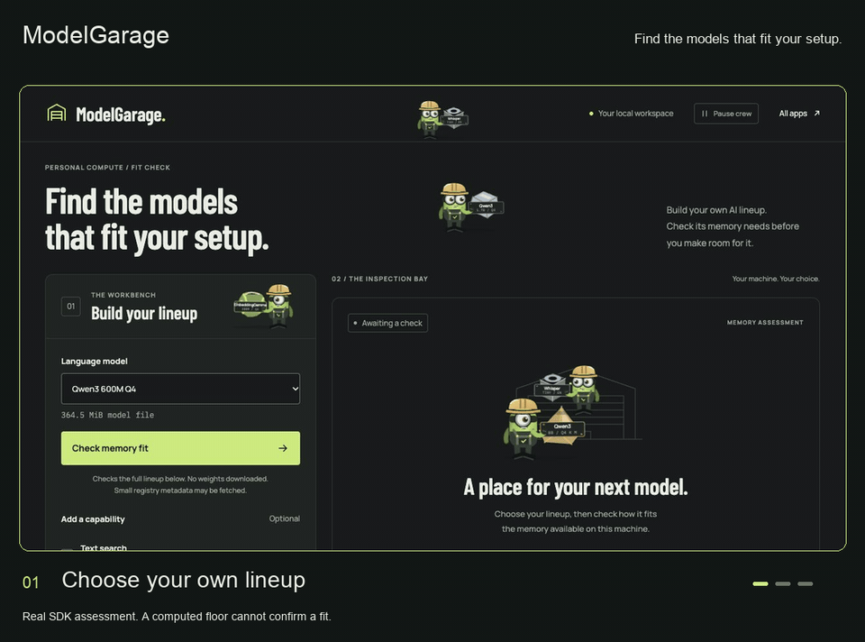

# ModelGarage

**Find the models that fit your setup.**

Build a local AI lineup, inspect its memory needs, and decide what belongs on your machine before downloading model weights. ModelGarage uses the real combined model assessment in **QVAC SDK 0.22.0**.



A graphite workbench, a lime inspection button, and a small crew of green workers. The crew carries model cargo through the garage while your own model choices stay in your hands.

## Run it

Use Node.js **22.21 or newer in the 22 series**, or **24.9 or newer**. The included `.nvmrc` selects 22.21.0.

```sh
git clone https://github.com/victorchimakanu/modelgarage.git
cd modelgarage
npm ci
npm start
```

Open [http://127.0.0.1:4323](http://127.0.0.1:4323). To choose another port:

```sh
PORT=4328 npm start
```

`npm ci` installs the SDK and its native runtime. It needs network access and a platform supported by the SDK. No API key is required. Model weights are not bundled.

## Take a lineup through the garage

1. Pick Qwen3 600M, 1.7B, 4B, or 8B.
2. Add EmbeddingGemma 300M for text search, Whisper Tiny English for speech recognition, or both.
3. Set the context window, which is how much text the language model can hold at once. Advanced settings let you choose a processor preference and sequential or concurrent operation.
4. Click **Check memory fit**. Read the combined verdict, available memory budget, reasons, and per model evidence. Save the result as JSON if useful.
5. Optionally acknowledge **Download and test load**. This may download missing weights and allocate memory, then release the models. It does not run inference, which means asking a model to produce an answer.

The first assessment may fetch small registry metadata. It does not download model weights or load models. Valid existing QVAC cache files are used only after their size and SHA256 checksum match the catalog descriptor.

The displayed **disk** total is the size of the model files, not their running memory use. Qwen3 8B alone is about 5.03 GB on disk.

## What a result means

| Result | Meaning |
| --- | --- |
| `likely-fits` | The available evidence suggests a fit. It reserves no memory and predicts no speed. |
| `likely-too-large` | The evidence rules out the combination under the current SDK budget. The app blocks its optional load test. |
| `unknown` | The available evidence cannot support a fit claim. The SDK's reasons stay visible. |

A **computed memory floor** is only a lower bound. It omits unmeasured costs and cannot confirm a fit. Missing native fitter support or an unavailable memory metric stays unknown. The app does not turn a model's file size into a made up memory estimate.

Both operation settings assume every selected model stays resident in memory. Sequential operation counts the largest working peak. Concurrent operation counts all working peaks. These settings estimate memory; they do not schedule work or unload models.

CUDA, Metal, Vulkan, and OpenCL are preferences for language and embedding models. A preference can fall back. CPU uses an explicit CPU device setting. Whisper uses CPU and a 30 second audio window.

## The optional load test

A test requires a matching prior assessment and your acknowledgement. Every model loads with `modelFitPolicy: 'refuse'`. This blocks definite failures from supported fitters. An unknown probe may still load, and free memory can change after an assessment.

The app reads actual device memory projections only when the engine returns them from `getLoadedModelInfo({ modelId }).fitProbe.projection`. A refused load shows the SDK error. It does not guarantee that a device table exists.

Loaded models are released in reverse order, including after a later load fails. Cleanup errors are reported. Cached weight files remain on disk. **Cancel load test** requests cancellation of the active load.

## A little life in the workbench

Tiny green workers carry Qwen3, EmbeddingGemma, and Whisper cargo. They are decorative and do not show download progress, model activity, or fit status.

**Pause crew** remembers your choice. Reduced motion shows still poses. Hidden tabs and workers outside the visible area pause. The crew never intercepts clicks or changes assessment results.

The visual system is in [design-dna.json](design-dna.json). Fonts are served locally, with their licenses in [THIRD_PARTY_NOTICES.md](THIRD_PARTY_NOTICES.md).

## Local data and network use

The server binds to `127.0.0.1` and rejects foreign origins. Opening the app and reading its catalog does not import the SDK, start its worker, assess a lineup, or load weights.

Assessment and load operations run locally. Registry metadata and explicit model downloads can use the network. The app has no cloud inference service, account, or telemetry. It keeps current results in server memory until restart. The crew pause choice stays in browser local storage.

A saved JSON report can include machine details and SDK error text. Review it before sharing. No model cache, personal report, or real machine verification artifact is included here.

## Develop and verify

```sh
npm test
```

The tests use an injected SDK test double and synthetic cache files. They cover catalog settings, combined assessment forwarding, cache checks, preserved unknown evidence, incomplete responses, explicit load consent, refusal, reverse cleanup, cleanup errors, cancellation, and local HTTP request boundaries. They download no weights and make no claim that a real model loaded. CI runs these tests on Node.js 22.21.0 with dependency install scripts disabled.

A real local check during development assessed Qwen3 600M plus EmbeddingGemma, a 2048 token context, CPU, and sequential operation. It returned `unknown` with `computed-only` evidence and a 791,473,888 byte combined floor. This is evidence that full catalog descriptors survive cache resolution. It is not proof of a fit or a successful load.

| Path | Purpose |
| --- | --- |
| [src/service.mjs](src/service.mjs) | Catalog validation, combined assessment, load refusal, and cleanup |
| [src/server.mjs](src/server.mjs) | Local server and API routes |
| [src/public](src/public) | Interface, local fonts, and decorative crew |
| [shared/qvac.mjs](shared/qvac.mjs) | Lazy SDK import and verified model cache resolution |
| [shared/http.mjs](shared/http.mjs) | Local HTTP boundaries and static files |
| [src/test](src/test) | Service tests with an injected SDK |

The project pins `@qvac/sdk` 0.22.0, `bare-runtime` 1.35.0, and `bare-tls` 3.1.12.

## API

| Route | Action |
| --- | --- |
| `GET /api/status` | Catalog and current in memory state |
| `POST /api/assess` | Assess the selected combination |
| `POST /api/load` | Explicitly download, load, inspect, and release |
| `POST /api/cancel` | Request cancellation of an active load |

An assessment accepts:

```json
{
  "languageModel": "qwen3-600m",
  "embedding": true,
  "speech": false,
  "contextTokens": 2048,
  "backend": "cpu",
  "execution": "sequential"
}
```

A load accepts the same settings under `selection`, plus `confirmDownloadAndLoad: true`. Only catalog IDs and documented settings are accepted. The browser cannot send arbitrary model paths, URLs, or SDK configuration. Native operations are serialized; an overlapping request receives HTTP 409.

## Sources and license

Built against the [SDK 0.22.0 release](https://github.com/tetherto/qvac/releases/tag/sdk-v0.22.0), the [tagged fit assessment guide](https://github.com/tetherto/qvac/blob/sdk-v0.22.0/packages/sdk/docs/assess-model-fit.md), and the [tagged load API](https://github.com/tetherto/qvac/blob/sdk-v0.22.0/packages/sdk/src/client/api/load-model.ts).

[MIT](LICENSE), copyright 2026 Victor Kanu. Dependency and model licenses remain their own.

Explore the companion apps: [PocketPacts](https://github.com/victorchimakanu/pocketpacts) and [QuoteMine](https://github.com/victorchimakanu/quotemine).
